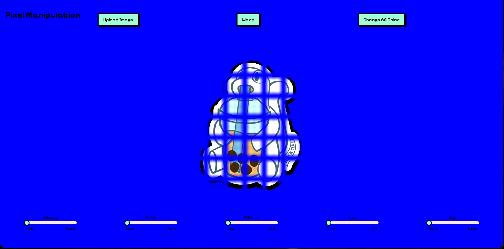
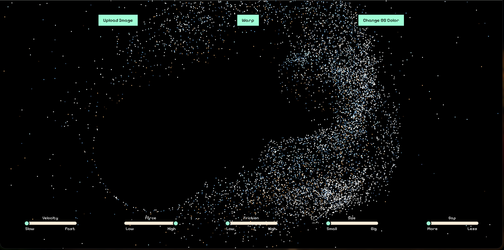

# Pixel Manipulation 
Here you can interact with pixels using your cursor. This is so satisfying.

# What Features this project contain
- You can interact with pixels using cursor
- you can try again and again by changing following properties 
    - Friction
    - Force
    - Velocity 
    - Gap between pixels
    - Size of pixels
    
- Custom image, you can upload your own custom image 
- You can change background color of canvas
- you can use Warp btn - which spawns all pixels at random postion 

# What is logic behind it (Algorithm)
1. It takes your image
2. uses base64 for src of your image
3. hides image
4. algorithm - looks for color of pixels on entire canvas while ignoring transparent ones
5. this happens using For loop - but it doesn't look for each pixels - there is size difined with which the pixels are look for
6. all that pixels remember thier color
7. The gap parameter decides the gap between each pixel and same for size paramter
8. Using mousmove event algorithm tracks the postion of cursor 
9. it sets that pixels should move away from cursor
10. if there is no contact with cursor the pixels starts to move to thier original postion - which was already stored at the time of pixel formaton

# Screenshots

---
